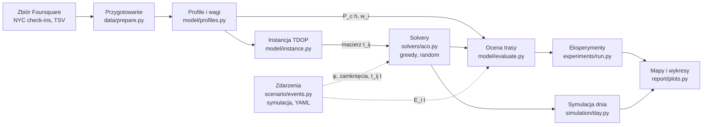

# 6. Architektura

System to potok w Pythonie: dane → profile → instancja → solver → ocena → raport. Moduł zdarzeń dodaje do potoku dane symulowane. Każdy moduł ma jedno zadanie i zapisuje wynik do pliku, więc można uruchomić każdy krok osobno.



Linia przerywana oznacza dane symulowane, nie z pomiaru. Moduł `model/evaluate.py` liczy zysk S_i(a_i) dla każdej metody tak samo, więc porównanie metod jest uczciwe.

## 6.1. Struktura repozytorium

```text
antroute/
├── data/
│   ├── raw/                  # dataset_TSMC2014_NYC.txt (nie w repozytorium)
│   └── prepare.py            # czas lokalny, filtr Manhattanu, kategorie
├── model/
│   ├── profiles.py           # P_c(h), wygładzanie, w_i
│   ├── instance.py           # wybór N miejsc, macierz t_ij
│   └── evaluate.py           # C_i(t), S_i(a_i), sprawdzenie ograniczeń
├── scenario/
│   ├── events.py             # E_i(t), zamknięcia, t_ij(t), antyferomon ze zdarzeń
│   └── examples/*.yaml       # gotowe scenariusze
├── solvers/
│   ├── aco.py                # ACS-A, ACS-B, antyferomon, ponowne planowanie
│   ├── greedy.py
│   └── random_route.py
├── simulation/
│   └── day.py                # symulacja dnia co godzinę, migawki stanu
├── experiments/
│   ├── configs/*.yaml        # E1–E13
│   └── run.py
├── report/
│   └── plots.py              # wykresy, mapy tras, mapy τ i φ, animacje
├── docs/                     # ta dokumentacja
└── tests/
```

## 6.2. Technologie

| Obszar | Biblioteka | Zastosowanie |
| --- | --- | --- |
| Dane | pandas, geopandas, shapely | wczytanie TSV, filtr wielokątem |
| Obliczenia | NumPy, Numba (opcjonalnie) | macierze τ, φ i t_ij, szybka pętla mrówek |
| Rozwiązanie dokładne | OR-Tools CP-SAT | best_known dla N = 25 |
| Statystyka | SciPy | test Wilcoxona |
| Scenariusze | PyYAML | wczytanie plików zdarzeń |
| Wizualizacja | matplotlib, folium | wykresy, mapy tras, animacje |
| Testy | pytest | testy jednostkowe modułów |

## 6.3. Interfejs wiersza poleceń

Uruchom solver dla jednego scenariusza:

```bash
python -m solvers.aco --n 50 --start 08:00 --budget 480 --variant A --seed 1 \
    --scenario scenario/examples/free_museum.yaml
```

Uruchom symulację dnia z migawkami co godzinę:

```bash
python -m simulation.day --n 50 --start 08:00 --budget 480 \
    --scenario scenario/examples/free_museum.yaml --step 60 --out runs/free_museum/
```

Wynik solvera to plik JSON z listą miejsc (Venue ID, kategoria, a_i, C_i, S_i) i plik HTML z mapą trasy.

> Polecenia są projektem interfejsu. Nazwy flag mogą się zmienić w trakcie implementacji.
