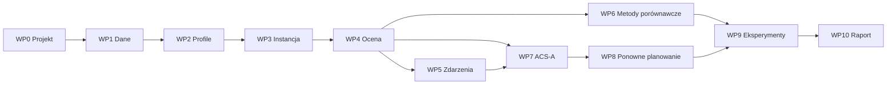

# 11. Zakres prac - wersja v1 (PoC)

Wersja v1 to pierwsza działająca wersja AntRoute. Priorytet to poprawny model, poprawny solver i wiarygodne wyniki eksperymentów. Wizualizacja w v1 jest minimalna: pliki CSV i JSON oraz kilka prostych wykresów. Ładne mapy, animacje i interfejs są poza zakresem v1.

Ten rozdział dzieli pracę na pakiety, podaje kryteria odbioru i listę decyzji, które trzeba podjąć przed implementacją.

## 11.1. Cel v1 i kryteria ukończenia

Wersja v1 jest gotowa, gdy wszystkie warunki z tabeli są spełnione.

| Nr | Kryterium | Jak sprawdzić |
| --- | --- | --- |
| K1 | Jedno polecenie uruchamia cały potok: dane → profile → instancja → solver → ocena → wyniki | `make all` albo skrypt `run_all.py` na czystym klonie z plikiem surowym w `data/raw/` |
| K2 | Przygotowanie danych odtwarza liczby z pliku `docs/data/hourly_checkins_nyc.csv` | test porównuje 11 × 24 liczby (cały Nowy Jork, wszystkie dni), różnica = 0 |
| K3 | Moduł oceny trasy (`model/evaluate.py`) ma testy jednostkowe dla każdego wzoru i każdego ograniczenia z rozdziału 3 | `pytest`, pokrycie modułu ≥ 90% |
| K4 | ACS-A znajduje optimum na małych instancjach | N ≤ 8: optimum z pełnego przeglądu w ≥ 95% uruchomień |
| K5 | ACS-A daje większy średni zysk niż metoda zachłanna | E1: średnia z 30 ziaren, test Wilcoxona, α = 0,05 |
| K6 | ACS-A jest blisko rozwiązania dokładnego | N = 25: średnia luka do CP-SAT ≤ 5% (cel, do potwierdzenia) |
| K7 | Wyniki są powtarzalne | to samo ziarno i ta sama konfiguracja dają identyczną trasę |
| K8 | Zdarzenia działają zgodnie z rozdziałem 5 | testy scenariuszy: zamknięte miejsce nie występuje w oknie, trasa reaguje na skok tłoku |
| K9 | Eksperymenty z priorytetem M (punkt 11.2) mają wyniki w CSV i krótkie wnioski | katalog `results/` + plik `results/SUMMARY.md` |

## 11.2. Zakres v1

Priorytety:

- **M** (must) - wchodzi do v1,
- **S** (should) - wchodzi do v1, gdy jest czas po zadaniach M,
- **poza v1** - następna wersja.

| Obszar | Element | Priorytet |
| --- | --- | --- |
| Dane | wczytanie TSV, czas lokalny, filtr Manhattanu, wybór kategorii | M |
| Dane | profile P_c(h) dla dnia roboczego i weekendu, wagi w_i | M |
| Dane | 20 wersji bootstrap profilu | S |
| Model | instancja TDOP: wybór N miejsc, macierz t_ij, czasy pobytu, K_c | M |
| Model | ocena trasy: C_i(t), S_i(a_i), wszystkie ograniczenia | M |
| Zdarzenia | YAML, `crowd_surge`, `closure`, `traffic`, pole `announced` | M |
| Solvery | trasa losowa, metoda zachłanna | M |
| Solvery | pełny przegląd dla N ≤ 8 (wyrocznia do testów) | M |
| Solvery | ACS-A z antyferomonem, ACS-noφ, ACS-static | M |
| Solvery | ponowne planowanie: zimny i ciepły start | M |
| Solvery | rozwiązanie dokładne CP-SAT dla N = 25 (best_known) | M |
| Solvery | przeszukiwanie lokalne po budowie trasy (punkt 11.4, decyzja D9) | S |
| Solvery | ACS-B (feromon zależny od pory dnia) | S |
| Eksperymenty | runner z konfiguracją YAML, 30 ziaren, metryki z punktu 8.4 | M |
| Eksperymenty | E1, E2, E4, E9, E10, E11, E12, E13 | M |
| Eksperymenty | E3 (wymaga ACS-B), E5, E6, E7, E8 (wymaga bootstrap) | S |
| Raport | CSV i JSON z wynikami, `SUMMARY.md` z tabelami | M |
| Raport | proste wykresy matplotlib: krzywa zbieżności, oś czasu trasy, wykres pudełkowy zysku | M |
| Raport | prosta mapa trasy w folium (bez suwaka) | S |
| Raport | animacje, mapa z suwakiem, Streamlit, ładne mapy τ i φ | poza v1 |
| Symulacja | symulacja dnia co godzinę (`simulation/day.py`) | poza v1 |
| Dane | godziny otwarcia z OpenStreetMap, macierz czasów z OSRM, Tokio | poza v1 |

Ponowne planowanie po zdarzeniu (punkt 4.5) jest w v1, bo E11 go wymaga. Pętla symulacji dnia co godzinę służy głównie do wizualizacji, więc jest poza v1.

## 11.3. Pakiety prac

Każdy pakiet ma zadania i kryterium odbioru. Kolejność pakietów odpowiada zależnościom (punkt 11.6).

### WP0. Przygotowanie projektu

1. Utwórz pakiet `antroute/` ze strukturą z punktu 6.1.
2. Dodaj `pyproject.toml` z przypiętymi wersjami bibliotek (Python ≥ 3.11).
3. Dodaj `pytest`, `ruff` i jedno polecenie do uruchomienia testów.
4. Dodaj plik `config/default.yaml` ze wszystkimi parametrami z punktu 4.7 i 2.3.
5. Dodaj `data/raw/`, `data/interim/`, `data/processed/` i `runs/` do `.gitignore`. Katalog `results/` zostaje w repozytorium, bo jest wynikiem v1 (kryterium K9).
6. Ustal jedno źródło losowości: `numpy.random.Generator` tworzony z ziarna i przekazywany jawnie do każdej funkcji.

**Odbiór:** `pytest` działa na pustym zestawie testów. Parametry nie są wpisane na stałe w kodzie.

### WP1. Dane (`data/prepare.py`)

1. Pobierz plik `dataset_TSMC2014_NYC.txt` do `data/raw/` (ręcznie, plik nie jest w repozytorium).
2. Pobierz wielokąt Manhattanu z NYC Borough Boundaries do `data/raw/`.
3. Wczytaj TSV (ISO-8859-1, bez nagłówka, 8 kolumn).
4. Przelicz czas UTC na czas lokalny: `local = utc + offset`.
5. Zapisz pełny zbiór z czasem lokalnym do `data/interim/checkins_nyc.parquet`.
6. Odrzuć check-iny poza Manhattanem i poza kategoriami z tabeli 2.2.
7. Zapisz wynik do `data/interim/checkins_manhattan.parquet`.

**Odbiór:**

- Histogram godzinowy z kroku 5 (cały Nowy Jork, wszystkie dni) jest równy `docs/data/hourly_checkins_nyc.csv` (kryterium K2). Ten test sprawdza konwersję stref czasowych.
- Zbiór ma 227 428 wierszy przed filtrem.
- Raport z liczbą check-inów i miejsc na Manhattanie dla każdej kategorii.

### WP2. Profile i wagi (`model/profiles.py`)

1. Policz histogram 24 godzin dla każdej kategorii, osobno dla dnia roboczego i weekendu.
2. Wygładź histogram cykliczną średnią kroczącą z oknem 3 h.
3. Znormalizuj profil do [0, 1].
4. Policz liczbę check-inów n_i dla każdego miejsca i wagę w_i.
5. Zapisz profile i wagi do pliku.
6. (S) Dodaj bootstrap: losuj dni ze zwracaniem i licz profil od nowa.

**Odbiór:**

- Testy: maksimum profilu = 1, wartości w [0, 1], wygładzanie łączy 23:00 z 0:00.
- Godziny szczytu na Manhattanie są zapisane w raporcie i porównane z tabelą 2.2.
- Raport z liczbą check-inów w każdej parze (kategoria, typ dnia). Patrz decyzja D5.

### WP3. Instancja (`model/instance.py`)

1. Wybierz miejsca z co najmniej 10 check-inami.
2. Wybierz N miejsc według reguły z decyzji D6.
3. Dodaj wierzchołek 0 (punkt startu).
4. Policz macierz t_ij: haversine × 1,3, prędkość 5 km/h, wynik w minutach.
5. Przypisz czas pobytu s_i z tabeli 2.2 i limit K_c.
6. Zapisz instancję do pliku (JSON + `.npz`), aby każdy solver dostał te same dane.

**Odbiór:** test sprawdza t_ii = 0, symetrię t_ij i wartość dla jednej znanej pary punktów. To samo ziarno daje tę samą instancję.

### WP4. Ocena trasy (`model/evaluate.py`)

To najważniejszy moduł v1. Każda metoda używa tylko tego modułu do liczenia zysku i sprawdzenia ograniczeń. Błąd w tym module zmienia wszystkie wyniki.

1. Zaimplementuj P_c(t) z interpolacją liniową (decyzja D2).
2. Zaimplementuj C_i(t) = P_c(i)(t) + E_i(t) i S_i(a_i).
3. Zaimplementuj czasy przybycia a_i z zależnym od czasu t_ij(t).
4. Zaimplementuj sprawdzenie ograniczeń: budżet, każde miejsce najwyżej raz, miejsce otwarte przez cały pobyt (decyzja D3), limit K_c.
5. Zwróć raport trasy: lista (Venue ID, kategoria, a_i, C_i, S_i), zysk, średni tłok, wykorzystanie budżetu, lista naruszeń.

**Odbiór (testy):**

- λ = 0: zysk nie zależy od godziny.
- λ = 1: miejsce w szczycie (C = 1) daje zysk 0.
- u_c = 0: miejsce kategorii c daje zysk 0.
- Interpolacja: brak skoku zysku o pełnej godzinie.
- Trasa, która wraca po T_0 + T_max, jest niedozwolona.
- Trasa z miejscem zamkniętym w części pobytu jest niedozwolona.
- Trasa ręcznie policzona na kartce (3 miejsca) daje ten sam zysk co moduł.

### WP5. Zdarzenia (`scenario/events.py`)

1. Wczytaj scenariusz YAML i sprawdź pola (błąd dla nieznanego typu lub brakującego pola).
2. Zaimplementuj E_i(t) dla `crowd_surge` ze spadkiem wykładniczym po t_e.
3. Zaimplementuj `closure` jako warunek w sprawdzeniu „miejsce otwarte”.
4. Zaimplementuj `traffic`: mnożnik m dla krawędzi w obszarze, gdy przejście zaczyna się w oknie (decyzja D4).
5. Zaimplementuj pole `announced`: zdarzenie jest widoczne dla solvera od chwili t_a.
6. Zaimplementuj φ^E dla 48 przedziałów 30-minutowych.
7. Dodaj gotowe scenariusze do `scenario/examples/`: brak zdarzeń, darmowe muzeum (rano i o 11:00), zamknięcie, parada, wszystkie razem.

**Odbiór:** testy dla każdego typu zdarzenia. Zdarzenie z t_a > T_0 nie zmienia planu porannego.

### WP6. Metody porównawcze (`solvers/`)

1. Trasa losowa: dodawaj losowe dozwolone miejsca, aż zbiór dozwolonych miejsc jest pusty.
2. Metoda zachłanna: w każdym kroku wybierz miejsce z największym η_ij(t).
3. Pełny przegląd dla N ≤ 8: sprawdź wszystkie dozwolone ciągi miejsc (najwyżej 109 601 ciągów dla N = 8). Ten solver to wyrocznia do testów ACS.
4. CP-SAT dla N = 25: model z czasem dyskretnym co 15 min (decyzja D10). Zapisz best_known dla każdej instancji z E1.

**Odbiór:** każdy wynik przechodzi przez `evaluate.py` bez naruszeń. CP-SAT daje zysk ≥ zysk zachłanny na tych samych instancjach (po ocenie w czasie ciągłym, z tolerancją z D10).

### WP7. ACS-A (`solvers/aco.py`)

1. Zaimplementuj budowę trasy jednej mrówki (punkt 4.1). Licz F(i) i η dla wszystkich kandydatów naraz w NumPy.
2. Zaimplementuj regułę wyboru z q_0 i antyferomonem (punkt 4.2).
3. Zaimplementuj lokalną i globalną aktualizację τ (punkt 4.3, decyzje D1 i D8).
4. Zaimplementuj antyferomon φ^A od mrówek z parowaniem (punkt 4.4).
5. Dodaj warianty przez parametry: ACS-noφ (γ = 0), ACS-static (λ = 0 tylko w solverze, ocena zawsze z λ z konfiguracji).
6. Dodaj kryterium stopu: liczba iteracji albo limit czasu.
7. Dodaj funkcję `on_iteration`, która zapisuje historię najlepszego zysku (dla E2). Pełne migawki τ i φ zapisuj tylko na żądanie.
8. (S) Dodaj przeszukiwanie lokalne najlepszej trasy iteracji (decyzja D9).
9. (S) Dodaj ACS-B (punkt 4.6).

**Odbiór:**

- Kryterium K4 (pełny przegląd) i K7 (powtarzalność).
- Test z γ = 0 i φ = 0: wynik jest taki sam jak w ACS bez kodu antyferomonu.
- Czas jednego uruchomienia dla N = 100 i 500 iteracji jest zapisany w raporcie. Gdy czas > 60 s, dodaj Numba (punkt 6.2).

### WP8. Ponowne planowanie (`solvers/aco.py`)

1. Zaimplementuj `instance.remaining(position, t_a, done)`: nowy start, pozostały budżet, odwiedzone miejsca poza zbiorem kandydatów, limity K_c pomniejszone o odwiedzone kategorie.
2. Zaimplementuj zimny i ciepły start z wyrównaniem κ (punkt 4.5).
3. Złóż trasę końcową: część wykonana + nowy plan. Oceń całą trasę w `evaluate.py`.

**Odbiór:** test sprawdza, że miejsca odwiedzone przed t_a są w trasie końcowej bez zmian. Trasa końcowa nie ma naruszeń.

**Uwaga:** użytkownik w chwili t_a może być w trakcie pobytu albo w trakcie przejścia. Patrz decyzja D7.

### WP9. Eksperymenty (`experiments/`)

1. Zaimplementuj runner: konfiguracja YAML → lista zadań (instancja × metoda × ziarno) → wyniki.
2. Zapisz każdy wynik jako jeden wiersz CSV: id eksperymentu, metoda, parametry instancji, ziarno, wszystkie metryki z punktu 8.4.
3. Zapisz trasy do JSON w `runs/<eksperyment>/`.
4. Uruchamiaj zadania równolegle (`multiprocessing`). Pomiń zadania, które mają już wynik.
5. Przygotuj konfiguracje E1, E2, E4, E9, E10, E11, E12, E13.
6. Policz statystyki: średnia, odchylenie, mediana, test Wilcoxona dla par metod.

**Uwaga:** E4 ma 81 kombinacji parametrów. Uruchom E4 na podzbiorze instancji z E1 (np. N = 50, jeden punkt startu), aby czas obliczeń był rozsądny.

**Odbiór:** kryteria K5, K6 i K9.

### WP10. Minimalny raport (`report/`)

1. Wygeneruj `results/SUMMARY.md` z tabelami wyników dla każdego eksperymentu.
2. Dodaj wykresy matplotlib (PNG, bez stylizacji):
   - krzywa zbieżności (E2, E11),
   - wykres pudełkowy zysku metod (E1, E13),
   - oś czasu trasy: trasa bez zdarzenia i ze zdarzeniem (E10, E12),
   - mapa ciepła wrażliwości parametrów (E4).
3. Dodaj 3-5 zdań wniosków do każdego eksperymentu.

**Odbiór:** jeden skrypt odtwarza wszystkie tabele i wykresy z plików CSV.

## 11.4. Decyzje przed implementacją

Analiza dokumentacji pokazała miejsca, które są niejasne albo mogą dać złe wyniki. Ustal te decyzje przed WP4 i WP7. Kolumna „Propozycja” to rekomendacja, nie ustalenie.

| Id | Temat | Problem | Propozycja |
| --- | --- | --- | --- |
| D1 | Skala τ_0 | Globalna aktualizacja dodaje ρ · Profit_best, a τ_0 = (N · Profit_greedy)^−1. Stosunek depozytu do τ_0 to ok. N · Profit², a nie N jak w ACS dla TSP. Gdy zysk jest rzędu 5-10, feromon na najlepszej trasie jest tysiące razy większy niż τ_0 i kolonia przestaje szukać. | Użyj τ_0 = Profit_greedy / N (ten sam stosunek co w TSP). Sprawdź obie wersje w E2 i E4. |
| D2 | Punkt interpolacji profilu | Histogram liczy check-iny w przedziale [h, h+1). Dokumentacja nie mówi, czy wartość P_c(h) należy do h:00 czy do h:30. | Przypisz P_c(h) do środka przedziału (h:30). |
| D3 | Sprawdzenie „otwarte przez cały pobyt” | Sprawdzenie w kilku punktach może pominąć minimum profilu w środku pobytu. | P_c(t) jest odcinkami liniowe, więc sprawdź końce pobytu i wszystkie węzły interpolacji w środku. Wynik jest dokładny. |
| D4 | Czas przejścia z utrudnieniem | Mnożnik zależy od chwili wyjścia. Wyjście tuż po t_e może dać wcześniejsze przybycie niż wyjście tuż przed t_e (brak własności FIFO). | Zostaw model z dokumentacji (brak czekania). Opisz ten efekt w ograniczeniach. Krawędź jest „w obszarze”, gdy odcinek i–j przecina koło. |
| D5 | Małe kategorie przy podziale na typ dnia | Museum ma 175 check-inów w całym Nowym Jorku. Po filtrze Manhattanu i podziale na weekend zostanie kilkadziesiąt. | Gdy para (kategoria, typ dnia) ma < 100 check-inów, połącz Museum z Art Museum albo użyj profilu z wszystkich dni. Zapisz regułę w konfiguracji. |
| D6 | Wybór N miejsc | Dokumentacja nie mówi, jak wybrać N miejsc. Top-N według n_i da prawie same bary i kawiarnie. | Losowanie warstwowe według kategorii z ziarnem: co najmniej 1 miejsce z każdej kategorii, reszta proporcjonalnie. Ta sama instancja dla wszystkich metod. |
| D7 | Pozycja użytkownika przy ogłoszeniu zdarzenia | Przy t_a użytkownik może być w trakcie pobytu albo przejścia. | Nowy start to najbliższe miejsce, w którym użytkownik kończy pobyt, i chwila końca tego pobytu. |
| D8 | Która trasa dostaje feromon globalnie | „Najlepsza trasa” może znaczyć najlepszą w iteracji albo najlepszą od początku. | Najlepsza od początku (global-best), jak w ACS (Dorigo i Gambardella 1997). Po zdarzeniu ocena „best” od nowa w nowej instancji. |
| D9 | Przeszukiwanie lokalne | Dokumentacja nie ma przeszukiwania lokalnego. ACS dla TSP i dla TOPTW (Montemanni i Gambardella 2009) używa go i to daje dużą część jakości. | Priorytet S: wstawianie miejsca, usuwanie miejsca, zamiana dwóch miejsc. Ocena każdej zmiany przez `evaluate.py`. Porównaj ACS z i bez tego kroku (nowy wariant w E1). |
| D10 | Rozwiązanie CP-SAT w czasie dyskretnym | Model co 15 min nie jest tym samym modelem co czas ciągły. Trasa z CP-SAT może być niedozwolona po ocenie w czasie ciągłym, a luka może być ujemna. | Oceń trasę z CP-SAT w `evaluate.py`. Nazwij wartość „best_known (CP-SAT, 15 min)”. Pokaż ujemne luki w raporcie zamiast je ukrywać. |
| D11 | Miasto | Rozdział 9 zostawia wybór: Manhattan albo Tokio. | v1 używa Manhattanu. |

## 11.5. Strategia weryfikacji

Poprawne wyniki wymagają kontroli na każdym poziomie. Celem jest wykrycie błędu w module, a nie dopiero w wyniku eksperymentu.

1. **Testy danych:** odtworzenie `hourly_checkins_nyc.csv` (K2), liczba wierszy, brak check-inów poza wielokątem.
2. **Testy wzorów:** każdy wzór z rozdziału 3 i 5 ma test z wartością policzoną ręcznie.
3. **Testy własności modelu:** zdania z punktu 3.2 są testami (λ = 0, λ = 1, u_c = 0).
4. **Wyrocznia:** ACS na instancjach N ≤ 8 porównany z pełnym przeglądem (K4).
5. **Jedna funkcja oceny:** każdy solver zwraca tylko trasę. Zysk liczy zawsze `evaluate.py`. Test sprawdza, że zysk zgłoszony przez solver jest równy zyskowi z `evaluate.py`.
6. **Powtarzalność:** to samo ziarno daje tę samą trasę (K7). Wyniki eksperymentów mają zapisaną wersję kodu (hash commit) i konfigurację.
7. **Testy sensu (sanity checks)** przed pełnymi eksperymentami:
   - ACS-static odwiedza miejsca w szczycie częściej niż ACS-A,
   - większy budżet daje zysk nie mniejszy (średnio),
   - zamknięte miejsce nie występuje w oknie zamknięcia,
   - zysk ACS-A ≥ zysk metody zachłannej w każdym uruchomieniu, bo ACS zaczyna z trasą zachłanną jako `best` (punkt 4.8).

## 11.6. Kolejność prac i kamienie milowe

| Kamień milowy | Pakiety | Wynik |
| --- | --- | --- |
| M1. Model gotowy | WP0-WP4 | dane, profile, instancja i ocena trasy z testami; kryteria K2 i K3 |
| M2. Solver bez zdarzeń | WP6 (bez CP-SAT), WP7 | losowa, zachłanna, pełny przegląd, ACS-A; kryteria K4 i K7; wstępne E1 i E2 |
| M3. Zdarzenia | WP5, WP8 | scenariusze YAML, antyferomon od zdarzeń, ponowne planowanie; kryterium K8; E10-E13 |
| M4. Wyniki v1 | WP6 (CP-SAT), WP9, WP10 | E1, E2, E4, E9-E13, `SUMMARY.md`; kryteria K1, K5, K6, K9 |
| M5. Rozszerzenia (S) | WP2 krok 6, WP7 kroki 8-9 | bootstrap, przeszukiwanie lokalne, ACS-B; E3, E5-E8 |

Decyzje D1-D11 ustal przed M1. Decyzje D1, D8 i D9 sprawdź ponownie po wstępnym E2 w M2.

## 11.7. Ryzyka v1

| Ryzyko | Skutek | Działanie |
| --- | --- | --- |
| Pętla mrówek w czystym Pythonie jest za wolna | E1 i E4 (30 ziaren, wiele instancji) trwają za długo | wektoryzacja kandydatów w NumPy; Numba tylko dla pętli budowy trasy; pomiar czasu w M2 |
| CP-SAT nie kończy obliczeń dla N = 25 w rozsądnym czasie | brak best_known | limit czasu i zapis najlepszego znalezionego rozwiązania z górnym ograniczeniem; luka liczona do górnego ograniczenia |
| Za mało check-inów po filtrze i podziale na typ dnia | zaszumione profile | decyzja D5; raport liczności w WP2 |
| Antyferomon nie poprawia wyników | E13 nie pokazuje różnicy | to też jest wynik; raport porównuje ACS-A z ACS-noφ uczciwie, z testem statystycznym |
| Zła skala τ_0 | przedwczesna zbieżność, ACS niewiele lepszy od metody zachłannej | decyzja D1, krzywa zbieżności w E2 |

## 11.8. Stan implementacji PoC

Wszystkie pakiety z priorytetem M są zrobione. Z pakietów S są zrobione: bootstrap, przeszukiwanie lokalne, ACS-B, E3, E5-E8 i prosta mapa folium (`antroute/report/plots.py`, funkcja `folium_route`). Wyniki i tabela kryteriów K1-K9 są w [`results/SUMMARY.md`](../results/SUMMARY.md).

| Pakiet | Kod | Stan |
| --- | --- | --- |
| WP0 | `pyproject.toml`, `config/default.yaml` | gotowe |
| WP1 | `antroute/data/prepare.py` | gotowe; K2 spełnione (różnica 0) |
| WP2 | `antroute/model/profiles.py` | gotowe, z bootstrap (20 wersji) |
| WP3 | `antroute/model/instance.py` | gotowe |
| WP4 | `antroute/model/evaluate.py` | gotowe; pokrycie testami 99% |
| WP5 | `antroute/scenario/events.py`, `antroute/scenario/examples/` | gotowe |
| WP6 | `antroute/solvers/{greedy,random_route,brute,exact}.py` | gotowe |
| WP7 | `antroute/solvers/aco.py`, `antroute/solvers/kernels.py` | gotowe (ACS-A, ACS-B, warianty, przeszukiwanie lokalne) |
| WP8 | `antroute/solvers/replan.py` | gotowe (zimny i ciepły start) |
| WP9 | `antroute/experiments/` | gotowe: E1, E2, E4-E8, E10-E12 (E3, E9, E13 to analizy) |
| WP10 | `antroute/report/`, `run_all.py` | gotowe |

Zmiany względem planu (szczegóły w `results/SUMMARY.md`):

1. Główna metoda to `acs_ls`: ACS-A + przeszukiwanie lokalne (D9) + q_0 = 0,5. Kryterium K4 dotyczy tej metody. ACS-A z parametrami z dokumentacji trafia w optimum tylko w ok. 63-70% uruchomień.
2. Liczba iteracji ACS to 2000, nie 500. Dzięki Numba jedno uruchomienie trwa zwykle < 1 s.
3. CP-SAT ma czas co 0,1 min i nadmiarowe ograniczenie budżetu, a nie czas co 15 min (D10).
4. Cel zdarzeń w E10-E12 jest wybierany automatycznie z trasy bez zdarzeń. Miejsce, którego trasa nie odwiedza, nie pokazuje reakcji na zdarzenie.
5. D7 ma poprawioną regułę: przejście w trakcie jest przerwane, a nowy start to poprzednie miejsce w chwili t_a. Pierwsza wersja zatwierdzała przejście do miejsca, które właśnie zamknięto.
6. Antyferomon ze zdarzeń powstaje także dla zamknięcia i utrudnienia w ruchu (parametr `phi_event_types`, docs/04 punkt 4.4). Nowy eksperyment E13b sprawdza antyferomon przy szybkim ponownym planowaniu.

Najważniejsze ograniczenie wyników: próg zamknięcia P_c(t) < 0,05 jest za niski. Bar rano albo muzeum przed 9:00 są „otwarte” i prawie puste, więc dają prawie pełny zysk. Solver poprawnie optymalizuje model, ale część tras nie jest realistyczna. Pierwsze zadanie na v2: godziny otwarcia dla kategorii albo z OpenStreetMap.
