# AntRoute PoC - wyniki eksperymentów

Wygenerowano: 2026-11-05, wersja kodu: `73b4040-dirty`. Plik generuje `python -m antroute.report.summary` z plików `results/*/results.csv`.

Wszystkie zyski liczy jedna funkcja `antroute/model/evaluate.py` na problemie ze wszystkimi zdarzeniami (prawda), z λ = 0,8, chyba że tabela mówi inaczej.

## Kryteria ukończenia v1

| Kryterium | Wynik |
| --- | --- |
| K1 | tak: `python run_all.py` (dane → profile → eksperymenty → raport) |
| K2 | tak: pytest - 46 passed in 5.62s (`test_k2_hourly_counts_match_reference`) |
| K3 | tak: pokrycie `evaluate.py` = 99% (cel ≥ 90%, pomiar z `NUMBA_DISABLE_JIT=1`); 46 passed in 5.62s |
| K4 | tak: pytest - 46 passed in 5.62s (`test_k4_acs_finds_brute_force_optimum`, ACS-LS) |
| K5 | tak: ACS-LS > greedy na 101/108 instancjach, p = < 0.0001 |
| K6 | tak: średnia luka ACS-LS do best_known = 0.09% (cel ≤ 5%); CP-SAT optimum w 24/36 instancji |
| K7 | tak: pytest - 46 passed in 5.62s (`test_k7_same_seed_same_route`) |
| K8 | tak: pytest - 46 passed in 5.62s (testy zdarzeń i ponownego planowania) |
| K9 | tak: ten plik |

### Decyzje implementacyjne (docs/11, punkt 11.4)

| Id | Decyzja w PoC | Podstawa |
| --- | --- | --- |
| D1 | τ_0 = Profit_greedy / N (opcja `tau0_mode: doc` = wzór z dokumentacji) | E4: z przeszukiwaniem lokalnym i q_0 = 0,5 luka 0,00% wobec 0,46% dla wzoru z dokumentacji; bez przeszukiwania lokalnego różnica jest mała i niejednoznaczna |
| D2 | P_c(h) w punkcie h:30, interpolacja liniowa, cyklicznie | test `test_profile_value_*` |
| D3 | dokładne sprawdzenie „otwarte”: końce pobytu + węzły interpolacji w środku | test `test_is_open_detects_closed_node_inside_stay` |
| D4 | mnożnik według chwili wyjścia, krawędź „w obszarze”, gdy odcinek przecina koło | test `test_segment_hits_circle` |
| D5 | < 100 check-inów → profil z wszystkich dni → profil grupy Museum+Art Museum | Museum ma 95 check-inów na Manhattanie |
| D6 | losowanie warstwowe (min. 1 miejsce z kategorii, reszta proporcjonalnie), ziarno 0 | ta sama instancja dla wszystkich metod |
| D7 | pobyt w trakcie: użytkownik go kończy, nowy start = to miejsce po pobycie; przejście w trakcie: przejście jest przerwane, nowy start = poprzednie miejsce w chwili t_a | E13b pokazał błąd pierwszej wersji (zatwierdzenie przejścia do miejsca zamkniętego w trakcie przejścia); test `test_replanning_drops_walk_to_venue_closed_during_the_walk` |
| D8 | aktualizacja globalna na trasie najlepszej od początku | jak w ACS (Dorigo i Gambardella 1997) |
| D9 | przeszukiwanie lokalne (wstaw, zamień, przenieś, zamień miejscami) na najlepszej trasie iteracji | E1, E2, E4, K4 |
| D10 | CP-SAT: czas co 0,1 min, tabele zysku co 1 min, nadmiarowe ograniczenie budżetu, podpowiedź z ACS | bez ograniczenia budżetu CP-SAT nie dowodzi optimum w 60 s |
| D11 | Manhattan | - |

### Zmiany parametrów względem dokumentacji

- **Główna metoda to `acs_ls`**: ACS-A + przeszukiwanie lokalne (D9) + q_0 = 0,5. Z q_0 = 0,9 (dokumentacja) ACS-A trafia w optimum na małych instancjach tylko w ok. 63-70% uruchomień (K4 nie jest spełnione). ACS-LS trafia w 100%.
- **Liczba iteracji: 2000** zamiast 500. Jedno uruchomienie trwa < 1 s (Numba), a 500 iteracji czasem kończy się przed wyjściem z optimum lokalnego (kontrola na scenariuszu E10).
- Wariant `acs_a` zostaje z parametrami z dokumentacji (q_0 = 0,9, β = 2) jako punkt odniesienia.

## E1. Jakość metod (bez zdarzeń)

108 instancji (4 punkty startu × 3 godziny × 3 budżety × 3 wartości N), persona `culture`, dzień roboczy, 30 ziaren dla metod losowych. Luka = (najlepszy znany zysk instancji − zysk) / najlepszy znany zysk. Najlepszy znany zysk to maksimum ze wszystkich metod, razem z CP-SAT.

| method | profit | profit_std | gap_pct | feasible | visits | avg_crowd | time_s |
| --- | --- | --- | --- | --- | --- | --- | --- |
| random | 0.698 | 0.367 | 54.885 | 1.000 | 4.385 | 0.484 | 0.001 |
| greedy | 1.238 | 0.485 | 18.185 | 1.000 | 5.139 | 0.489 | 0.000 |
| acs_a | 1.488 | 0.581 | 2.887 | 1.000 | 5.309 | 0.398 | 0.307 |
| acs_b | 1.484 | 0.578 | 3.122 | 1.000 | 5.327 | 0.400 | 0.303 |
| acs_ls | 1.541 | 0.625 | 0.185 | 1.000 | 5.423 | 0.388 | 0.938 |
| acs_ls+nophi | 1.541 | 0.625 | 0.200 | 1.000 | 5.411 | 0.388 | 0.842 |
| acs_ls+static | 1.271 | 0.537 | 17.676 | 1.000 | 5.831 | 0.583 | 0.621 |
| cpsat | 1.460 | 0.604 | 0.000 | 1.000 | 4.861 | 0.385 | 48.173 |

Średnia luka [%] według N:

| method | N=25 | N=50 | N=100 |
| --- | --- | --- | --- |
| random | 48.41 | 56.74 | 59.50 |
| greedy | 17.70 | 16.87 | 19.99 |
| acs_a | 1.85 | 2.91 | 3.91 |
| acs_b | 1.91 | 3.09 | 4.37 |
| acs_ls | 0.09 | 0.25 | 0.21 |
| acs_ls+nophi | 0.09 | 0.29 | 0.22 |
| acs_ls+static | 17.02 | 16.07 | 19.93 |
| cpsat | 0.00 |  |  |

Średnia luka [%] według budżetu T_max [min]:

| method | T_max=240 | T_max=480 | T_max=720 |
| --- | --- | --- | --- |
| random | 56.11 | 55.40 | 53.15 |
| greedy | 12.63 | 18.93 | 23.00 |
| acs_a | 0.83 | 2.61 | 5.23 |
| acs_b | 0.87 | 2.95 | 5.54 |
| acs_ls | 0.00 | 0.31 | 0.25 |
| acs_ls+nophi | 0.00 | 0.33 | 0.27 |
| acs_ls+static | 18.70 | 16.42 | 17.91 |
| cpsat | 0.00 | 0.00 | 0.00 |

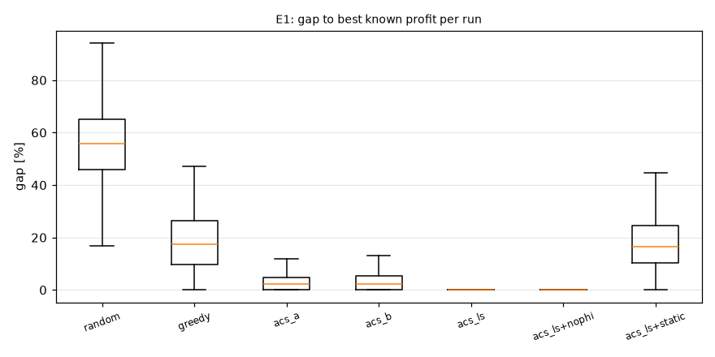

Test Wilcoxona na średnich z 30 ziaren dla każdej instancji (para A-B):

| A | B | instancje | śr. różnica | A lepsza | remis | B lepsza | p (Wilcoxon) |
| --- | --- | --- | --- | --- | --- | --- | --- |
| acs_ls | greedy | 108 | 0.3032 | 101 | 7 | 0 | < 0.0001 |
| acs_a | greedy | 108 | 0.2502 | 101 | 7 | 0 | < 0.0001 |
| acs_ls | acs_a | 108 | 0.0529 | 82 | 26 | 0 | < 0.0001 |
| acs_ls | acs_ls+nophi | 108 | 0.0003 | 24 | 69 | 15 | 0.2379 |
| acs_a | random | 108 | 0.7898 | 108 | 0 | 0 | < 0.0001 |

### K6. Luka do CP-SAT dla N = 25

CP-SAT (czas 0,1 min, tabela zysku co 1 min, limit 120 s, podpowiedź z najlepszej trasy ACS-LS) udowodnił optimum w 24 z 36 instancji. Wszystkie trasy CP-SAT oceniono ponownie w `evaluate.py` (D10).

| metryka | wartość |
| --- | --- |
| średnia luka ACS-LS do best_known [%] | 0.094 |
| maks. luka ACS-LS do best_known [%] | 2.079 |
| średnia luka ACS-LS do górnego ograniczenia CP-SAT [%] | 5.676 |
| średnia luka ACS-LS do CP-SAT na instancjach z dowodem optimum [%] | 0.048 |
| instancje, gdzie ACS-LS (najlepsze ziarno) = best_known | 35.000 |

**Wnioski.**

- ACS-LS ma średnią lukę 0,19% do najlepszego znanego zysku. ACS-A ma 2,9%, metoda zachłanna 18,2%, trasa losowa 54,9%.
- ACS-LS jest lepszy od metody zachłannej na prawie każdej instancji i nigdy nie jest gorszy (start od trasy zachłannej). Kryterium K5 jest spełnione.
- Luka ACS-A rośnie z N i z budżetem. Luka ACS-LS jest prawie stała, bo przeszukiwanie lokalne poprawia kolejność wizyt.
- Wszystkie trasy wszystkich metod są dozwolone (0 naruszeń w 19 548 uruchomieniach).
- Koszt ACS-LS to ok. 1 s na uruchomienie (maks. ok. 17 s dla N = 100 i 12 h).
- K6: dla N = 25 średnia luka ACS-LS do best_known wynosi 0,09%. Na 24 instancjach, gdzie CP-SAT udowodnił optimum, luka wynosi 0,05%. Najlepsze ziarno ACS-LS osiąga best_known na 35 z 36 instancji. Górne ograniczenie CP-SAT jest słabe dla budżetu 12 h (średnia luka do niego 5,7%), więc dla tych instancji nie ma dowodu optymalności.

## E3. Feromon zależny od pory dnia (ACS-A vs ACS-B)

Na 108 instancjach E1: ACS-B lepszy 36×, remis 29×, gorszy 43×. Średnia różnica zysku (B − A) = -0.0045, p (Wilcoxon) = 0.2474.

| budget | luka acs_a [%] | luka acs_b [%] |
| --- | --- | --- |
| 240.000 | 0.829 | 0.867 |
| 480.000 | 2.606 | 2.954 |
| 720.000 | 5.225 | 5.545 |

**Wnioski.**

- Feromon zależny od pory dnia (ACS-B) nie poprawia wyniku. Na instancjach E1 różnica między ACS-B i ACS-A nie jest istotna (p = 0,25), a średnio ACS-B jest trochę gorszy. W E2 przy budżecie 12 h ACS-B jest wyraźnie gorszy.
- Powód: 8 macierzy feromonu dzieli tę samą liczbę depozytów na 8 części, więc każda macierz uczy się wolniej. Informacja o porze dnia jest już w heurystyce η, która zna godzinę przybycia.
- Rekomendacja: zostaw ACS-B jako wariant badawczy, nie jako metodę domyślną.

## E9. Omijanie tłoku (ACS-LS vs ACS-LS bez kary za tłok)

Obie trasy oceniono z λ = 0,8. `peak_visits` = liczba wizyt z tłokiem C > θ = 0,7.

| method | profit | avg_crowd | peak_visits | visits |
| --- | --- | --- | --- | --- |
| acs_ls | 1.541 | 0.388 | 0.487 | 5.423 |
| acs_ls+static | 1.271 | 0.583 | 2.212 | 5.831 |

Średni tłok na trasie jest większy bez kary za tłok na 106 z 108 instancji, p (Wilcoxon) = < 0.0001.

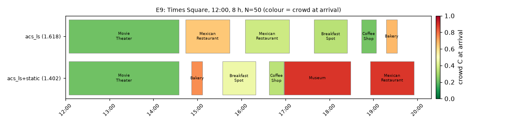

**Wnioski.**

- Kara za tłok działa: bez kary (`acs_ls+static`) średni tłok na trasie rośnie z ok. 0,39 do ok. 0,58, a liczba wizyt w szczycie (C > 0,7) rośnie kilka razy.
- Trasa bez kary ma mniejszy prawdziwy zysk (oceniany z λ = 0,8), na poziomie metody zachłannej.
- Oś czasu pokazuje typowy efekt: trasa bez kary idzie do muzeum o 17:00, w szczycie; trasa z karą omija muzeum w tym czasie.

## E2. Zbieżność

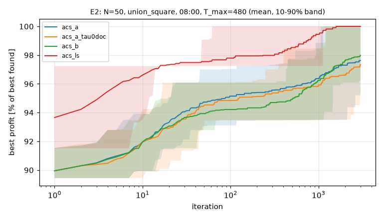

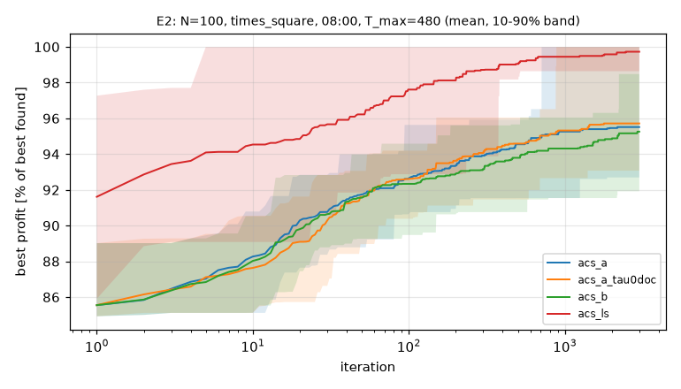

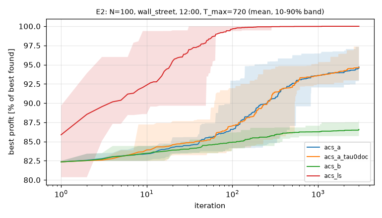

| instancja | metoda | zysk po 500 it. [% ref] | zysk końcowy [% ref] | min końcowy [% ref] | it. do 99% końcowego |
| --- | --- | --- | --- | --- | --- |
| N=50 union_square 08:00 T_max=480 | acs_a | 95.78 | 97.63 | 93.49 | 828.00 |
| N=50 union_square 08:00 T_max=480 | acs_a_tau0doc | 95.59 | 97.34 | 93.47 | 1105.00 |
| N=50 union_square 08:00 T_max=480 | acs_b | 94.91 | 97.99 | 93.49 | 1231.50 |
| N=50 union_square 08:00 T_max=480 | acs_ls | 98.53 | 100.00 | 100.00 | 567.00 |
| N=100 times_square 08:00 T_max=480 | acs_a | 94.55 | 95.51 | 91.54 | 357.00 |
| N=100 times_square 08:00 T_max=480 | acs_a_tau0doc | 94.59 | 95.71 | 91.54 | 309.00 |
| N=100 times_square 08:00 T_max=480 | acs_b | 93.79 | 95.26 | 91.54 | 438.00 |
| N=100 times_square 08:00 T_max=480 | acs_ls | 99.05 | 99.73 | 98.64 | 97.50 |
| N=100 wall_street 12:00 T_max=720 | acs_a | 92.52 | 94.71 | 87.13 | 617.00 |
| N=100 wall_street 12:00 T_max=720 | acs_a_tau0doc | 92.06 | 94.65 | 91.73 | 565.50 |
| N=100 wall_street 12:00 T_max=720 | acs_b | 86.15 | 86.56 | 85.55 | 275.50 |
| N=100 wall_street 12:00 T_max=720 | acs_ls | 99.96 | 100.00 | 100.00 | 28.00 |

**Wnioski.**

- ACS-LS zbiega najszybciej i najpewniej: 100% najlepszego zysku w każdym uruchomieniu na dwóch z trzech instancji i 99,7% średnio na trzeciej.
- ACS-A i ACS-B kończą na ok. 95-98% po 3000 iteracjach, z dużym rozrzutem między ziarnami.
- Wzór τ_0 z dokumentacji (`acs_a_tau0doc`) i wzór D1 dają prawie te same krzywe dla ACS-A. Skala τ_0 nie jest główną przyczyną słabej zbieżności ACS-A. Główna przyczyna to silna eksploatacja (q_0 = 0,9) i brak poprawy lokalnej kolejności wizyt.
- ACS-B jest wyraźnie najwolniejszy przy budżecie 12 h (86,6%).

## E4. Wrażliwość parametrów i decyzje projektowe

ACS-A, N = 50, 4 instancje, 30 ziaren. Luka liczona do najlepszego zysku dla tej samej instancji i tej samej wartości λ (λ zmienia funkcję celu).

Efekt główny `beta`:

| beta | gap_pct | profit | avg_crowd | time_s |
| --- | --- | --- | --- | --- |
| 1.000 | 1.253 | 1.689 | 0.388 | 0.304 |
| 2.000 | 1.728 | 1.681 | 0.397 | 0.305 |
| 5.000 | 3.390 | 1.654 | 0.428 | 0.300 |

Efekt główny `q0`:

| q0 | gap_pct | profit | avg_crowd | time_s |
| --- | --- | --- | --- | --- |
| 0.500 | 1.434 | 1.686 | 0.392 | 0.302 |
| 0.700 | 1.591 | 1.684 | 0.395 | 0.304 |
| 0.900 | 2.312 | 1.672 | 0.409 | 0.304 |
| 0.980 | 3.159 | 1.658 | 0.420 | 0.302 |

Efekt główny `m`:

| m | gap_pct | profit | avg_crowd | time_s |
| --- | --- | --- | --- | --- |
| 5.000 | 2.298 | 1.672 | 0.405 | 0.140 |
| 10.000 | 2.123 | 1.675 | 0.406 | 0.262 |
| 20.000 | 1.951 | 1.678 | 0.402 | 0.506 |

Efekt główny `lam`:

| lam | gap_pct | profit | avg_crowd | time_s |
| --- | --- | --- | --- | --- |
| 0.400 | 1.389 | 1.940 | 0.466 | 0.308 |
| 0.800 | 2.529 | 1.612 | 0.401 | 0.305 |
| 1.000 | 2.453 | 1.472 | 0.346 | 0.296 |

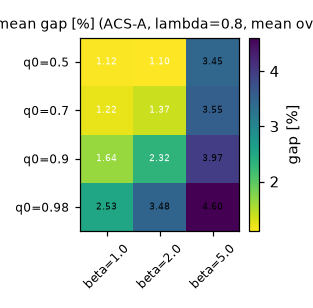

Decyzje D1 (wzór τ_0) i D9 (przeszukiwanie lokalne), λ = 0,8:

| tau0_mode | local_search | q0 | gap_pct | gap_max | time_s |
| --- | --- | --- | --- | --- | --- |
| doc | False | 0.500 | 1.177 | 3.853 | 0.269 |
| doc | False | 0.900 | 1.849 | 6.529 | 0.275 |
| doc | True | 0.500 | 0.462 | 2.758 | 0.314 |
| doc | True | 0.900 | 1.383 | 2.758 | 0.276 |
| profit_over_n | False | 0.500 | 0.959 | 2.963 | 0.270 |
| profit_over_n | False | 0.900 | 2.135 | 6.718 | 0.267 |
| profit_over_n | True | 0.500 | 0.000 | 0.000 | 0.405 |
| profit_over_n | True | 0.900 | 1.434 | 2.758 | 0.287 |

**Wnioski.**

- Mniejsze β i mniejsze q_0 dają lepsze trasy. Wartości z dokumentacji (β = 2, q_0 = 0,9) nie są najlepsze dla tego problemu. Najlepsze w siatce: β = 1, q_0 = 0,5.
- Więcej mrówek (m = 20) daje mały zysk jakości za dwa razy dłuższy czas.
- λ zmienia funkcję celu: λ = 0,4 daje większy zysk i większy tłok, λ = 1 daje mniejszy tłok (0,35 wobec 0,47).
- Tabela decyzji: przeszukiwanie lokalne + q_0 = 0,5 + τ_0 według D1 daje lukę 0,00% we wszystkich 120 uruchomieniach. To potwierdza wybór metody głównej.

## E5. Godzina startu

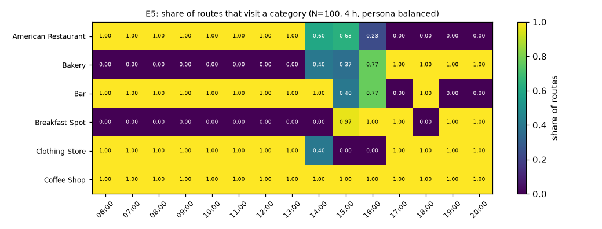

| index | 06:00 | 07:00 | 08:00 | 09:00 | 10:00 | 11:00 | 12:00 | 13:00 | 14:00 | 15:00 | 16:00 | 17:00 | 18:00 | 19:00 | 20:00 |
| --- | --- | --- | --- | --- | --- | --- | --- | --- | --- | --- | --- | --- | --- | --- | --- |
| profit | 1.90 | 1.76 | 1.77 | 1.72 | 1.72 | 1.62 | 1.58 | 1.58 | 1.59 | 1.63 | 1.57 | 1.47 | 1.47 | 1.60 | 1.80 |
| visits | 4.00 | 4.00 | 4.00 | 4.00 | 4.00 | 4.00 | 4.00 | 4.00 | 3.40 | 3.37 | 3.77 | 4.00 | 4.00 | 4.00 | 4.00 |
| avg_crowd | 0.18 | 0.22 | 0.21 | 0.28 | 0.30 | 0.36 | 0.38 | 0.39 | 0.32 | 0.28 | 0.35 | 0.48 | 0.47 | 0.40 | 0.28 |

**Wnioski.**

- Wczesny start (06:00-08:00) i późny start (20:00) dają największy zysk i najmniejszy tłok (0,18-0,28). Start o 17:00-18:00 daje najmniejszy zysk i największy tłok (0,48).
- Mapa ciepła pokazuje, że trasa dobiera kategorie do pory dnia. Piekarnia i Breakfast Spot pojawiają się dopiero przy starcie od 14:00-15:00, a American Restaurant znika przy starcie od 17:00.
- **Ważne ograniczenie modelu.** Persona `balanced` odwiedza bar przy starcie 06:00-14:00. Bar ma wtedy P_c = 0,06-0,11: jest „otwarty” według progu 0,05 z dokumentacji i prawie pusty, więc daje prawie pełny zysk. Ten sam efekt daje muzeum o 08:24 (P_c ok. 0,2) w E10-E12. Model nagradza wizytę tuż nad progiem zamknięcia.
- Solver działa poprawnie w ramach modelu, ale te trasy nie są realistyczne. Zadanie na v2: godziny otwarcia dla kategorii (tabela założeń jak czasy pobytu) albo z OpenStreetMap, ewentualnie kara za bardzo mały ruch.

## E6. Preferencje (persony)

| persona | zysk | wizyty | Jaccard (ziarna) | najczęstsze kategorie |
| --- | --- | --- | --- | --- |
| balanced | 3.277 | 7.000 | 1.000 | American Restaurant, Clothing Store, Bakery, Mexican Restaurant |
| culture | 1.685 | 6.767 | 0.800 | American Restaurant, Park, Coffee Shop, Bakery |
| foodie | 2.910 | 7.000 | 0.853 | American Restaurant, Mexican Restaurant, Bakery, Bar |
| night_owl | 2.144 | 7.000 | 1.000 | American Restaurant, Mexican Restaurant, Bar, Bakery |

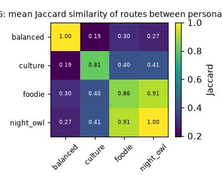

100 losowych profili u_c ~ U(0, 1): średni Jaccard między profilami = 0.316; liczba różnych tras = 67.

**Wnioski.**

- Persony dają różne trasy: kategorie w trasie odpowiadają wagom u_c (na przykład `night_owl` i `foodie` mają bary i restauracje).
- Trasy są stabilne między ziarnami (Jaccard 0,8-1,0), więc różnice między personami to efekt preferencji, nie losowości.
- 100 losowych profili daje 67 różnych tras.

## E7. Punkt startu

| start_point | profit | visits | budget_use | avg_crowd |
| --- | --- | --- | --- | --- |
| met_museum | 1.611 | 5.000 | 0.999 | 0.351 |
| times_square | 1.685 | 6.767 | 0.999 | 0.444 |
| union_square | 1.757 | 6.000 | 0.994 | 0.427 |
| wall_street | 1.670 | 5.567 | 0.991 | 0.328 |

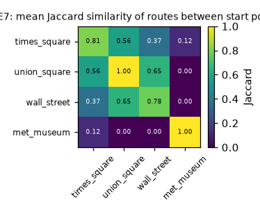

**Wnioski.**

- Punkt startu zmienia trasę bardziej niż ziarno. Trasy z tego samego punktu mają Jaccard 0,78-1,0. Trasy z Times Square, Union Square i Wall Street dzielą część miejsc (0,37-0,65). Trasy z Metropolitan Museum są prawie rozłączne z innymi (0-0,12), bo start jest daleko na północy.
- Zysk zależy od punktu startu w małym stopniu (1,61-1,76). Budżet jest prawie w pełni wykorzystany we wszystkich punktach.

## E8. Stabilność danych (bootstrap)

20 wersji bootstrap × 10 ziaren = 200 tras. Stabilny rdzeń (miejsca w ≥ 80% tras): 2 miejsc. Średnia liczba wizyt na trasie: 6.31.

| venue_id | udział tras | kategoria |
| --- | --- | --- |
| 428a8580f964a52083231fe3 | 1.00 | American Restaurant |
| 477a3514f964a520214d1fe3 | 0.87 | American Restaurant |
| 49e3a2b3f964a520a6621fe3 | 0.60 | Coffee Shop |
| 423e0e80f964a52046201fe3 | 0.59 | Bakery |
| 4b240a1ff964a520b25f24e3 | 0.56 | Park |
| 49f5135cf964a5208e6b1fe3 | 0.56 | Museum |
| 43ed7e9ef964a5204e2f1fe3 | 0.52 | Mexican Restaurant |
| 4e0530f6ae60a90eabbacc01 | 0.40 | Breakfast Spot |
| 3fd66200f964a5208be41ee3 | 0.28 | Bakery |
| 4ada106af964a520ed1d21e3 | 0.23 | Coffee Shop |

Trasa z profilu bootstrap oceniona na profilu z pełnych danych traci średnio 1.16% zysku (maks. 9.90%) względem trasy planowanej na pełnych danych.

**Wnioski.**

- Tylko 2 miejsca (dwie restauracje) są w ≥ 80% tras dla 20 wersji danych bootstrap. Reszta trasy zmienia się z wersją danych.
- Trasa z profilu bootstrap, oceniona na profilu z pełnych danych, traci średnio ok. 1% zysku (maks. ok. 10%). Model jest dość odporny na szum w danych, ale konkretne miejsca w trasie nie są stabilne.

## E10. Zdarzenie znane rano (skok tłoku 10:00-13:00, np. darmowe wejście)

Miejsce zdarzenia to miejsce, które plan bez zdarzenia (acs_ls, ziarno 0) odwiedza w oknie 10:00-13:00, najpierw muzea. start 08:00: `4a0203cef964a52024711fe3` (plan bez zdarzenia: 10:04); start 10:00: `4adcdc95f964a520046221e3` (plan bez zdarzenia: 10:04). N = 50, Times Square, 8 h, persona `culture`, siła s = 1. Kolumny `cel_*` dotyczą miejsca zdarzenia.

| t0 | decay_min | variant_label | zysk | koszt | dozwolona | cel_w_trasie | cel_w_oknie | przybycie |
| --- | --- | --- | --- | --- | --- | --- | --- | --- |
| 08:00 | 30 | acs_ls | 1.670 | 0.004 | 1.000 | 1.000 | 0.000 | 14:40 |
| 08:00 | 30 | acs_ls+nophi | 1.670 | 0.004 | 1.000 | 1.000 | 0.000 | 14:40 |
| 08:00 | 30 | fixed | 1.627 | 0.047 | 1.000 | 1.000 | 1.000 | 10:04 |
| 08:00 | 30 | greedy | 1.437 | 0.237 | 1.000 | 0.000 | 0.000 |  |
| 08:00 | 60 | acs_ls | 1.664 | 0.010 | 1.000 | 0.000 | 0.000 |  |
| 08:00 | 60 | acs_ls+nophi | 1.664 | 0.010 | 1.000 | 0.000 | 0.000 |  |
| 08:00 | 60 | fixed | 1.627 | 0.047 | 1.000 | 1.000 | 1.000 | 10:04 |
| 08:00 | 60 | greedy | 1.437 | 0.237 | 1.000 | 0.000 | 0.000 |  |
| 08:00 | 180 | acs_ls | 1.664 | 0.010 | 1.000 | 0.000 | 0.000 |  |
| 08:00 | 180 | acs_ls+nophi | 1.664 | 0.010 | 1.000 | 0.000 | 0.000 |  |
| 08:00 | 180 | fixed | 1.627 | 0.047 | 1.000 | 1.000 | 1.000 | 10:04 |
| 08:00 | 180 | greedy | 1.437 | 0.237 | 1.000 | 0.000 | 0.000 |  |
| 10:00 | 30 | acs_ls | 1.656 | 0.101 | 1.000 | 1.000 | 0.000 | 16:53 |
| 10:00 | 30 | acs_ls+nophi | 1.656 | 0.101 | 1.000 | 1.000 | 0.000 | 16:54 |
| 10:00 | 30 | fixed | 1.570 | 0.187 | 1.000 | 1.000 | 0.967 | 10:18 |
| 10:00 | 30 | greedy | 1.622 | 0.135 | 1.000 | 1.000 | 0.000 | 16:53 |
| 10:00 | 60 | acs_ls | 1.652 | 0.105 | 1.000 | 1.000 | 0.000 | 16:56 |
| 10:00 | 60 | acs_ls+nophi | 1.652 | 0.105 | 1.000 | 1.000 | 0.000 | 16:54 |
| 10:00 | 60 | fixed | 1.570 | 0.188 | 1.000 | 1.000 | 0.967 | 10:18 |
| 10:00 | 60 | greedy | 1.618 | 0.140 | 1.000 | 1.000 | 0.000 | 16:53 |
| 10:00 | 180 | acs_ls | 1.648 | 0.109 | 1.000 | 0.000 | 0.000 |  |
| 10:00 | 180 | acs_ls+nophi | 1.648 | 0.109 | 1.000 | 0.000 | 0.000 |  |
| 10:00 | 180 | fixed | 1.568 | 0.189 | 1.000 | 1.000 | 0.967 | 10:18 |
| 10:00 | 180 | greedy | 1.565 | 0.192 | 1.000 | 1.000 | 0.000 | 16:53 |

Trasy bez zdarzenia (acs_ls, 30 ziaren):

| t0 | zysk | cel_w_trasie | cel_w_oknie | przybycie |
| --- | --- | --- | --- | --- |
| 08:00 | 1.674 | 1.000 | 1.000 | 10:04 |
| 10:00 | 1.757 | 1.000 | 0.967 | 10:18 |

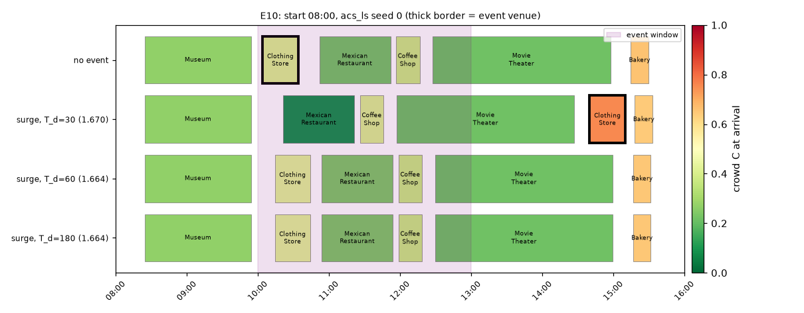

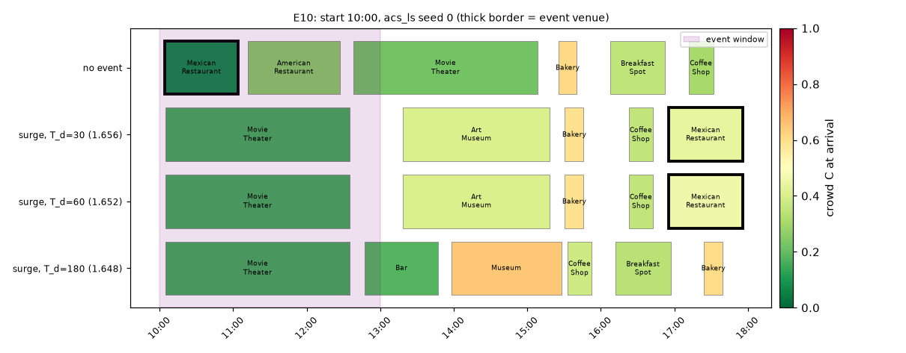

**Wnioski.**

- Plan bez zdarzeń nie odwiedza muzeum w oknie 10:00-13:00 (odwiedza je o 08:24 albo wcale). Dlatego miejsce zdarzenia to sklep z ubraniami (start 08:00) i meksykańska restauracja (start 10:00), które ten plan odwiedza o 10:04.
- Gdy zdarzenie jest znane rano, ACS-LS nigdy nie odwiedza miejsca w oknie zdarzenia. Przy krótkim spadku tłoku (T_d = 30 min) przesuwa wizytę na popołudnie (14:40 albo 16:53). Przy długim spadku (T_d = 180 min) częściej usuwa miejsce z trasy.
- Koszt zdarzenia dla ACS-LS to 0,004-0,010 przy starcie 08:00 i ok. 0,10 przy starcie 10:00. Plan bez zmian (`fixed`) traci 0,047 i 0,19, czyli 2-10 razy więcej.
- Większe T_d daje większy koszt, zgodnie z docs 5.1.

## E11. Zdarzenie w trakcie dnia (ogłoszone o 11:00)

Skok tłoku 10:00-13:00 (s = 1, T_d = 60 min) w miejscu `4a5e9b4af964a520e4be1fe3`, które plan poranny (acs_ls, ziarno 0) odwiedza o 11:56. Ponowne planowanie: 50 iteracji. `fixed` = plan bez zdarzenia bez zmian.

Zysk bez zdarzenia: 1.6738. Zysk, gdy zdarzenie jest znane rano: 1.6537.

| variant_label | zysk | std | dozwolona | cel_w_trasie | cel_w_oknie | koszt vs bez zdarzenia | strata vs wiedza rano |
| --- | --- | --- | --- | --- | --- | --- | --- |
| acs_a_cold | 1.6482 | 0.0033 | 1.0000 | 0.0000 | 0.0000 | 0.0255 | 0.0054 |
| acs_a_warm | 1.6467 | 0.0052 | 1.0000 | 0.0000 | 0.0000 | 0.0270 | 0.0069 |
| acs_ls+nophi_cold | 1.6471 | 0.0000 | 1.0000 | 0.0000 | 0.0000 | 0.0267 | 0.0066 |
| acs_ls+nophi_warm | 1.6471 | 0.0000 | 1.0000 | 0.0000 | 0.0000 | 0.0267 | 0.0066 |
| acs_ls_cold | 1.6471 | 0.0000 | 1.0000 | 0.0000 | 0.0000 | 0.0267 | 0.0066 |
| acs_ls_warm | 1.6471 | 0.0000 | 1.0000 | 0.0000 | 0.0000 | 0.0267 | 0.0066 |
| fixed | 1.5174 | 0.0000 | 1.0000 | 1.0000 | 1.0000 | 0.1564 | 0.1363 |
| greedy | 1.4368 |  | 1.0000 | 1.0000 | 0.0000 | 0.2370 | 0.2168 |

Krzywa powrotu po zdarzeniu. Ref = najlepszy zysk podproblemu z wariantu zimnego i ciepłego dla tego samego ziarna i tej samej metody. Iteracja 1 zaczyna od trasy zachłannej podproblemu, więc próg 95% jest łatwy; kolumna „it. do 100% ref” lepiej różnicuje warianty:

| wariant | zysk po 1 it. [% ref] | po 5 it. | po 10 it. | po 50 it. | it. do 95% ref (mediana) | it. do 100% ref (średnia) | ref osiągnięty [% uruchomień] |
| --- | --- | --- | --- | --- | --- | --- | --- |
| acs_a_cold | 98.69 | 98.82 | 99.06 | 99.87 | 1.00 | 16.23 | 86.67 |
| acs_a_warm | 98.80 | 99.18 | 99.18 | 99.73 | 1.00 | 26.27 | 73.33 |
| acs_ls+nophi_cold | 97.36 | 99.24 | 99.99 | 100.00 | 1.00 | 2.70 | 100.00 |
| acs_ls+nophi_warm | 96.96 | 99.61 | 99.92 | 100.00 | 1.00 | 2.90 | 100.00 |
| acs_ls_cold | 96.61 | 99.25 | 99.99 | 100.00 | 1.00 | 2.47 | 100.00 |
| acs_ls_warm | 95.91 | 99.24 | 99.99 | 100.00 | 1.00 | 3.03 | 100.00 |

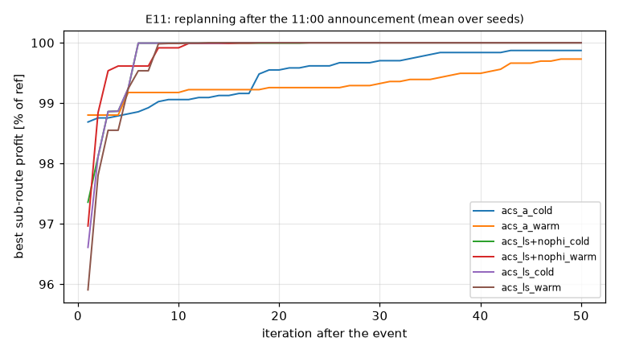

**Wnioski.**

- Ponowne planowanie o 11:00 odzyskuje prawie cały zysk: strata wobec wiedzy od rana to ok. 0,007, a plan bez zmian (`fixed`) traci ok. 0,136.
- Ciepły start nie jest lepszy od zimnego w tym scenariuszu. Oba warianty ACS-LS osiągają najlepszy zysk podproblemu w każdym uruchomieniu, średnio w ok. 3 iteracje. Podproblem po 11:00 jest mały (3-4 wizyty), a trasa zachłanna już jest blisko optimum.
- Dla ACS-A ciepły start jest nawet trochę gorszy (73% wobec 87% uruchomień z najlepszym zyskiem): stary feromon kieruje mrówki na stare krawędzie.
- Wniosek: korzyść z ciepłego startu (Guntsch i Middendorf 2001) nie pojawia się przy małych podproblemach. Przy większym podproblemie i małej liczbie iteracji ciepły start wyraźnie pomaga (E13b).

## E12. Zamknięcie miejsca i utrudnienie w ruchu

Zamknięte 08:00-12:00: pierwsze miejsce planu bez zdarzeń (`45ab7c7af964a52044411fe3`). Parada: Times Square, promień 400 m, 12:00-15:00, mnożnik czasu przejścia 2. Zdarzenia są znane rano.

Zysk bez zdarzeń: 1.6738. Trasa `fixed` z naruszeniem ograniczeń jest niewykonalna w rzeczywistości; jej zysk podano tylko dla porównania.

| scenario | variant_label | zysk | dozwolona | zamkniete_w_trasie | wizyty | koszt |
| --- | --- | --- | --- | --- | --- | --- |
| closure | acs_ls | 1.6429 | 1.0000 | 1.0000 | 6.0000 | 0.0309 |
| closure | acs_ls+nophi | 1.6429 | 1.0000 | 1.0000 | 6.0000 | 0.0309 |
| closure | fixed | 1.6738 | 0.0000 | 1.0000 | 6.0000 | -0.0000 |
| closure | greedy | 1.4597 | 1.0000 | 0.0000 | 5.0000 | 0.2141 |
| closure+parade | acs_ls | 1.6160 | 1.0000 | 1.0000 | 6.0000 | 0.0578 |
| closure+parade | acs_ls+nophi | 1.6160 | 1.0000 | 1.0000 | 6.0000 | 0.0578 |
| closure+parade | fixed | 1.6815 | 0.0000 | 1.0000 | 6.0000 | -0.0077 |
| closure+parade | greedy | 1.4597 | 1.0000 | 0.0000 | 5.0000 | 0.2141 |
| parade | acs_ls | 1.6566 | 1.0000 | 1.0000 | 5.0000 | 0.0172 |
| parade | acs_ls+nophi | 1.6564 | 1.0000 | 1.0000 | 5.0333 | 0.0173 |
| parade | fixed | 1.6815 | 0.0000 | 1.0000 | 6.0000 | -0.0077 |
| parade | greedy | 1.4085 | 1.0000 | 1.0000 | 6.0000 | 0.2653 |

**Wnioski.**

- Zamknięcie i parada mają mały koszt dla ACS-LS (0,02-0,06). ACS-LS odwiedza zamknięte muzeum po 12:00, gdy jest już otwarte.
- Plan bez zdarzeń (`fixed`) jest niewykonalny we wszystkich trzech scenariuszach: wizyta w zamkniętym miejscu albo powrót po czasie przez paradę.
- Metoda zachłanna traci 0,21-0,27 zysku.

## E13. Rola antyferomonu (acs_ls vs acs_ls+nophi)

| eksperyment | pary | śr. różnica (z φ − bez φ) | z φ lepszy | remis | bez φ lepszy | p (Wilcoxon) |
| --- | --- | --- | --- | --- | --- | --- |
| E10 | 180 | 0.0000 | 2 | 176 | 2 | 0.9987 |
| E11 | 60 | 0.0000 | 0 | 60 | 0 | 1.0000 |
| E12 | 90 | 0.0000 | 1 | 89 | 0 | 0.8357 |

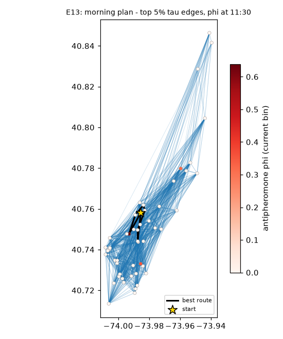

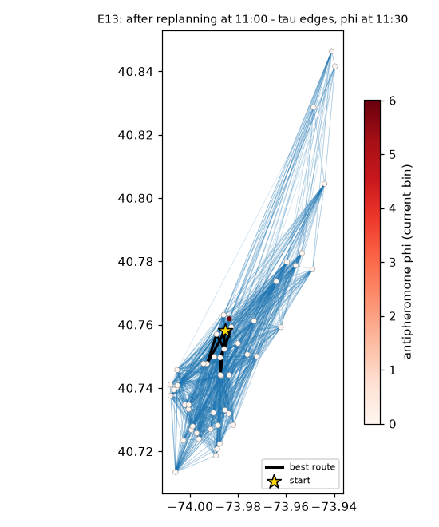

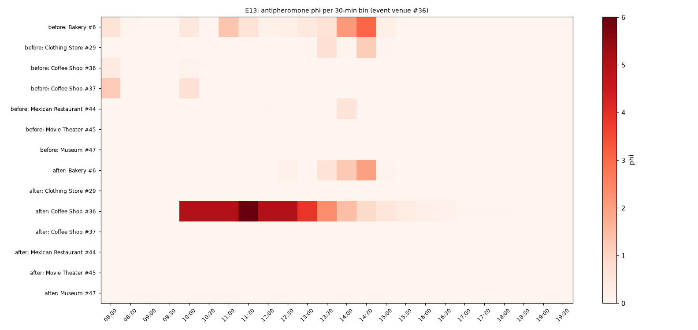

**Wnioski.**

- Antyferomon nie zmienia wyniku ACS-LS w E11 i E12 (prawie wszystkie pary to remisy) ani średnio w E1 (różnica w granicach szumu).
- Powód: heurystyka η już karze tłok w chwili przybycia, a przeszukiwanie lokalne poprawia trasę niezależnie od feromonu. Antyferomon powtarza tę samą informację.
- Antyferomon jest przydatny jako wizualizacja pamięci kolonii: mapa φ pokazuje miejsce zdarzenia w oknie zdarzenia.
- Rekomendacja: zostaw antyferomon (γ = 1) jako opcję. Nie ma dowodu, że pomaga albo szkodzi. Test w trudniejszych warunkach jest w E13b.

## E13b. Antyferomon przy szybkim ponownym planowaniu

Scenariusz: start 09:00 (Times Square, N = 100, 8 h, persona `culture`), zdarzenie ogłoszone o 10:23 i aktywne do 15:00. Zdarzenie trafia w pierwsze przejście planu bez zdarzeń po 10:23 (wyjście o 11:30) i w miejsce `4b240a1ff964a520b25f24e3` na końcu tego przejścia. Trzy typy: `accident` (wypadek: promień 250 m, czas przejścia ×50), `closure` (zamknięcie miejsca), `surge` (skok tłoku). Ponowne planowanie ma 10 albo 50 iteracji, z ciepłym albo zimnym startem. `g0`/`g1`/`g3` = γ; `phidoc` = antyferomon ze zdarzeń tylko dla skoku tłoku (docs 4.4), bez `phidoc` = także dla wypadku i zamknięcia.

| scenario | group | zysk it10 cold | zysk it10 warm | zysk it50 cold | zysk it50 warm | dozwolona |
| --- | --- | --- | --- | --- | --- | --- |
| accident | acs_a_g0 | 1.4581 | 1.5640 | 1.5379 | 1.5982 | 1.0000 |
| accident | acs_a_g1 | 1.4449 | 1.5478 | 1.5634 | 1.5962 | 1.0000 |
| accident | acs_a_g1_phidoc | 1.4449 | 1.5478 | 1.5634 | 1.5962 | 1.0000 |
| accident | acs_a_g3 | 1.4641 | 1.5538 | 1.5454 | 1.6000 | 1.0000 |
| accident | acs_ls_g0 | 1.5992 | 1.6202 | 1.6139 | 1.6213 | 1.0000 |
| accident | acs_ls_g1 | 1.5820 | 1.6194 | 1.6047 | 1.6221 | 1.0000 |
| closure | acs_a_g0 | 1.4579 | 1.5557 | 1.5546 | 1.5898 | 1.0000 |
| closure | acs_a_g1 | 1.4333 | 1.5534 | 1.5569 | 1.5953 | 1.0000 |
| closure | acs_a_g1_phidoc | 1.4333 | 1.5534 | 1.5569 | 1.5953 | 1.0000 |
| closure | acs_a_g3 | 1.4612 | 1.5647 | 1.5703 | 1.5954 | 1.0000 |
| closure | acs_ls_g0 | 1.5830 | 1.6196 | 1.6104 | 1.6205 | 1.0000 |
| closure | acs_ls_g1 | 1.5950 | 1.6196 | 1.6074 | 1.6201 | 1.0000 |
| surge | acs_a_g0 | 1.4486 | 1.5703 | 1.5504 | 1.5981 | 1.0000 |
| surge | acs_a_g1 | 1.4468 | 1.5635 | 1.5506 | 1.6019 | 1.0000 |
| surge | acs_a_g1_phidoc | 1.4468 | 1.5635 | 1.5506 | 1.6019 | 1.0000 |
| surge | acs_a_g3 | 1.4661 | 1.5647 | 1.5681 | 1.5954 | 1.0000 |
| surge | acs_ls_g0 | 1.5677 | 1.6199 | 1.5951 | 1.6209 | 1.0000 |
| surge | acs_ls_g1 | 1.5878 | 1.6159 | 1.6085 | 1.6220 | 1.0000 |

Pary według ziarna (końcowy zysk całego dnia, ocena na prawdzie):

| zdarzenie | it. | start | A | B | śr. różnica A − B | A lepsza | remis | B lepsza | p |
| --- | --- | --- | --- | --- | --- | --- | --- | --- | --- |
| accident | 10 | cold | acs_a_g1 | acs_a_g0 | -0.0131 | 16 | 1 | 13 | 0.5104 |
| accident | 10 | cold | acs_a_g3 | acs_a_g0 | 0.0060 | 19 | 1 | 10 | 0.4590 |
| accident | 10 | cold | acs_a_g1 | acs_a_g1_phidoc | 0.0000 | 0 | 30 | 0 | 1.0000 |
| accident | 10 | cold | acs_ls_g1 | acs_ls_g0 | -0.0172 | 9 | 10 | 11 | 0.3472 |
| accident | 10 | warm | acs_a_g1 | acs_a_g0 | -0.0162 | 9 | 2 | 19 | 0.1558 |
| accident | 10 | warm | acs_a_g3 | acs_a_g0 | -0.0102 | 15 | 1 | 14 | 0.7577 |
| accident | 10 | warm | acs_a_g1 | acs_a_g1_phidoc | 0.0000 | 0 | 30 | 0 | 1.0000 |
| accident | 10 | warm | acs_ls_g1 | acs_ls_g0 | -0.0008 | 3 | 20 | 7 | 0.3263 |
| accident | 50 | cold | acs_a_g1 | acs_a_g0 | 0.0255 | 21 | 0 | 9 | 0.0148 |
| accident | 50 | cold | acs_a_g3 | acs_a_g0 | 0.0075 | 15 | 1 | 14 | 0.5928 |
| accident | 50 | cold | acs_a_g1 | acs_a_g1_phidoc | 0.0000 | 0 | 30 | 0 | 1.0000 |
| accident | 50 | cold | acs_ls_g1 | acs_ls_g0 | -0.0093 | 12 | 6 | 12 | 0.4523 |
| accident | 50 | warm | acs_a_g1 | acs_a_g0 | -0.0021 | 12 | 4 | 14 | 0.7342 |
| accident | 50 | warm | acs_a_g3 | acs_a_g0 | 0.0018 | 13 | 1 | 16 | 0.9180 |
| accident | 50 | warm | acs_a_g1 | acs_a_g1_phidoc | 0.0000 | 0 | 30 | 0 | 1.0000 |
| accident | 50 | warm | acs_ls_g1 | acs_ls_g0 | 0.0008 | 6 | 18 | 6 | 0.9579 |
| closure | 10 | cold | acs_a_g1 | acs_a_g0 | -0.0246 | 12 | 1 | 17 | 0.1558 |
| closure | 10 | cold | acs_a_g3 | acs_a_g0 | 0.0033 | 16 | 0 | 14 | 0.7655 |
| closure | 10 | cold | acs_a_g1 | acs_a_g1_phidoc | 0.0000 | 0 | 30 | 0 | 1.0000 |
| closure | 10 | cold | acs_ls_g1 | acs_ls_g0 | 0.0120 | 7 | 13 | 10 | 0.8032 |
| closure | 10 | warm | acs_a_g1 | acs_a_g0 | -0.0023 | 14 | 3 | 13 | 0.7812 |
| closure | 10 | warm | acs_a_g3 | acs_a_g0 | 0.0090 | 14 | 1 | 15 | 0.7189 |
| closure | 10 | warm | acs_a_g1 | acs_a_g1_phidoc | 0.0000 | 0 | 30 | 0 | 1.0000 |
| closure | 10 | warm | acs_ls_g1 | acs_ls_g0 | 0.0001 | 6 | 20 | 4 | 0.6236 |
| closure | 50 | cold | acs_a_g1 | acs_a_g0 | 0.0022 | 16 | 1 | 13 | 0.4344 |
| closure | 50 | cold | acs_a_g3 | acs_a_g0 | 0.0157 | 16 | 2 | 12 | 0.1254 |
| closure | 50 | cold | acs_a_g1 | acs_a_g1_phidoc | 0.0000 | 0 | 30 | 0 | 1.0000 |
| closure | 50 | cold | acs_ls_g1 | acs_ls_g0 | -0.0030 | 7 | 10 | 13 | 0.2228 |
| closure | 50 | warm | acs_a_g1 | acs_a_g0 | 0.0055 | 16 | 2 | 12 | 0.5104 |
| closure | 50 | warm | acs_a_g3 | acs_a_g0 | 0.0056 | 14 | 0 | 16 | 0.7498 |
| closure | 50 | warm | acs_a_g1 | acs_a_g1_phidoc | 0.0000 | 0 | 30 | 0 | 1.0000 |
| closure | 50 | warm | acs_ls_g1 | acs_ls_g0 | -0.0004 | 5 | 21 | 4 | 0.8300 |
| surge | 10 | cold | acs_a_g1 | acs_a_g0 | -0.0018 | 15 | 0 | 15 | 0.8394 |
| surge | 10 | cold | acs_a_g3 | acs_a_g0 | 0.0175 | 17 | 1 | 12 | 0.2667 |
| surge | 10 | cold | acs_a_g1 | acs_a_g1_phidoc | 0.0000 | 0 | 30 | 0 | 1.0000 |
| surge | 10 | cold | acs_ls_g1 | acs_ls_g0 | 0.0201 | 12 | 8 | 10 | 0.3809 |
| surge | 10 | warm | acs_a_g1 | acs_a_g0 | -0.0067 | 11 | 4 | 15 | 0.3545 |
| surge | 10 | warm | acs_a_g3 | acs_a_g0 | -0.0055 | 16 | 1 | 13 | 0.9836 |
| surge | 10 | warm | acs_a_g1 | acs_a_g1_phidoc | 0.0000 | 0 | 30 | 0 | 1.0000 |
| surge | 10 | warm | acs_ls_g1 | acs_ls_g0 | -0.0040 | 4 | 21 | 5 | 0.7152 |
| surge | 50 | cold | acs_a_g1 | acs_a_g0 | 0.0002 | 14 | 2 | 14 | 0.9344 |
| surge | 50 | cold | acs_a_g3 | acs_a_g0 | 0.0177 | 17 | 2 | 11 | 0.1386 |
| surge | 50 | cold | acs_a_g1 | acs_a_g1_phidoc | 0.0000 | 0 | 30 | 0 | 1.0000 |
| surge | 50 | cold | acs_ls_g1 | acs_ls_g0 | 0.0133 | 14 | 7 | 9 | 0.2322 |
| surge | 50 | warm | acs_a_g1 | acs_a_g0 | 0.0038 | 15 | 4 | 11 | 0.3763 |
| surge | 50 | warm | acs_a_g3 | acs_a_g0 | -0.0027 | 15 | 3 | 12 | 0.8855 |
| surge | 50 | warm | acs_a_g1 | acs_a_g1_phidoc | 0.0000 | 0 | 30 | 0 | 1.0000 |
| surge | 50 | warm | acs_ls_g1 | acs_ls_g0 | 0.0012 | 5 | 22 | 3 | 0.5743 |

Zysk podproblemu po 1, 5 iteracjach i na końcu, w % najlepszego zysku tego podproblemu (to samo ziarno i ten sam wariant, wszystkie ustawienia iteracji i startu):

| zdarzenie | wariant | it. | start | po 1 it. | po 5 it. | na końcu |
| --- | --- | --- | --- | --- | --- | --- |
| accident | acs_a_g0 | 10 | cold | 79.33 | 85.65 | 88.85 |
| accident | acs_a_g0 | 10 | warm | 92.09 | 96.24 | 96.95 |
| accident | acs_a_g0 | 50 | cold | 79.33 | 85.65 | 94.93 |
| accident | acs_a_g0 | 50 | warm | 92.09 | 96.24 | 99.58 |
| accident | acs_a_g1 | 10 | cold | 83.34 | 85.99 | 87.94 |
| accident | acs_a_g1 | 10 | warm | 91.20 | 94.25 | 95.60 |
| accident | acs_a_g1 | 50 | cold | 83.34 | 85.99 | 96.89 |
| accident | acs_a_g1 | 50 | warm | 91.20 | 94.25 | 99.44 |
| accident | acs_a_g1_phidoc | 10 | cold | 83.34 | 85.99 | 87.94 |
| accident | acs_a_g1_phidoc | 10 | warm | 91.20 | 94.25 | 95.60 |
| accident | acs_a_g1_phidoc | 50 | cold | 83.34 | 85.99 | 96.89 |
| accident | acs_a_g1_phidoc | 50 | warm | 91.20 | 94.25 | 99.44 |
| accident | acs_a_g3 | 10 | cold | 82.11 | 85.35 | 89.05 |
| accident | acs_a_g3 | 10 | warm | 91.41 | 95.31 | 95.88 |
| accident | acs_a_g3 | 50 | cold | 82.11 | 85.35 | 95.22 |
| accident | acs_a_g3 | 50 | warm | 91.41 | 95.31 | 99.55 |
| accident | acs_ls_g0 | 10 | cold | 93.91 | 97.56 | 98.05 |
| accident | acs_ls_g0 | 10 | warm | 98.93 | 99.43 | 99.83 |
| accident | acs_ls_g0 | 50 | cold | 93.91 | 97.56 | 99.17 |
| accident | acs_ls_g0 | 50 | warm | 98.93 | 99.43 | 99.91 |
| accident | acs_ls_g1 | 10 | cold | 92.47 | 95.98 | 96.66 |
| accident | acs_ls_g1 | 10 | warm | 98.83 | 99.71 | 99.71 |
| accident | acs_ls_g1 | 50 | cold | 92.47 | 95.98 | 98.39 |
| accident | acs_ls_g1 | 50 | warm | 98.83 | 99.71 | 99.87 |
| closure | acs_a_g0 | 10 | cold | 79.88 | 85.26 | 89.24 |
| closure | acs_a_g0 | 10 | warm | 92.31 | 95.36 | 96.71 |
| closure | acs_a_g0 | 50 | cold | 79.88 | 85.26 | 96.68 |
| closure | acs_a_g0 | 50 | warm | 92.31 | 95.36 | 99.44 |
| closure | acs_a_g1 | 10 | cold | 83.37 | 85.10 | 87.31 |
| closure | acs_a_g1 | 10 | warm | 90.93 | 94.59 | 96.21 |
| closure | acs_a_g1 | 50 | cold | 83.37 | 85.10 | 96.43 |
| closure | acs_a_g1 | 50 | warm | 90.93 | 94.59 | 99.64 |
| closure | acs_a_g1_phidoc | 10 | cold | 83.37 | 85.10 | 87.31 |
| closure | acs_a_g1_phidoc | 10 | warm | 90.93 | 94.59 | 96.21 |
| closure | acs_a_g1_phidoc | 50 | cold | 83.37 | 85.10 | 96.43 |
| closure | acs_a_g1_phidoc | 50 | warm | 90.93 | 94.59 | 99.64 |
| closure | acs_a_g3 | 10 | cold | 81.89 | 85.64 | 89.24 |
| closure | acs_a_g3 | 10 | warm | 91.43 | 95.72 | 97.01 |
| closure | acs_a_g3 | 50 | cold | 81.89 | 85.64 | 97.52 |
| closure | acs_a_g3 | 50 | warm | 91.43 | 95.72 | 99.43 |
| closure | acs_ls_g0 | 10 | cold | 92.84 | 96.24 | 96.74 |
| closure | acs_ls_g0 | 10 | warm | 99.00 | 99.52 | 99.78 |
| closure | acs_ls_g0 | 50 | cold | 92.84 | 96.24 | 98.96 |
| closure | acs_ls_g0 | 50 | warm | 99.00 | 99.52 | 99.84 |
| closure | acs_ls_g1 | 10 | cold | 93.49 | 96.48 | 97.65 |
| closure | acs_ls_g1 | 10 | warm | 99.07 | 99.66 | 99.69 |
| closure | acs_ls_g1 | 50 | cold | 93.49 | 96.48 | 98.66 |
| closure | acs_ls_g1 | 50 | warm | 99.07 | 99.66 | 99.72 |
| surge | acs_a_g0 | 10 | cold | 79.88 | 86.10 | 88.12 |
| surge | acs_a_g0 | 10 | warm | 93.05 | 95.95 | 97.37 |
| surge | acs_a_g0 | 50 | cold | 79.88 | 86.10 | 95.83 |
| surge | acs_a_g0 | 50 | warm | 93.05 | 95.95 | 99.55 |
| surge | acs_a_g1 | 10 | cold | 82.97 | 85.35 | 88.05 |
| surge | acs_a_g1 | 10 | warm | 90.63 | 94.35 | 96.65 |
| surge | acs_a_g1 | 50 | cold | 82.97 | 85.35 | 95.67 |
| surge | acs_a_g1 | 50 | warm | 90.63 | 94.35 | 99.75 |
| surge | acs_a_g1_phidoc | 10 | cold | 82.97 | 85.35 | 88.05 |
| surge | acs_a_g1_phidoc | 10 | warm | 90.63 | 94.35 | 96.65 |
| surge | acs_a_g1_phidoc | 50 | cold | 82.97 | 85.35 | 95.67 |
| surge | acs_a_g1_phidoc | 50 | warm | 90.63 | 94.35 | 99.75 |
| surge | acs_a_g3 | 10 | cold | 81.90 | 85.98 | 89.59 |
| surge | acs_a_g3 | 10 | warm | 91.45 | 95.74 | 97.03 |
| surge | acs_a_g3 | 50 | cold | 81.90 | 85.98 | 97.36 |
| surge | acs_a_g3 | 50 | warm | 91.45 | 95.74 | 99.46 |
| surge | acs_ls_g0 | 10 | cold | 91.99 | 93.73 | 95.52 |
| surge | acs_ls_g0 | 10 | warm | 98.84 | 99.80 | 99.80 |
| surge | acs_ls_g0 | 50 | cold | 91.99 | 93.73 | 97.77 |
| surge | acs_ls_g0 | 50 | warm | 98.84 | 99.80 | 99.87 |
| surge | acs_ls_g1 | 10 | cold | 93.46 | 96.87 | 97.02 |
| surge | acs_ls_g1 | 10 | warm | 98.78 | 99.36 | 99.36 |
| surge | acs_ls_g1 | 50 | cold | 93.46 | 96.87 | 98.59 |
| surge | acs_ls_g1 | 50 | warm | 98.78 | 99.36 | 99.83 |

**Wnioski.**

- Scenariusz z rozmowy z zespołem: start 09:00, wypadek, zamknięcie albo skok tłoku ogłoszony o 10:23. Każdy wariant reaguje poprawnie: 0 tras niewykonalnych w 2160 uruchomieniach, a nowy plan omija zdarzenie.
- **Antyferomon ze zdarzenia dla wypadku i zamknięcia nie zmienia żadnej trasy** (`acs_a_g1` = `acs_a_g1_phidoc` w 30/30 parach, w każdym ustawieniu). To wynika z konstrukcji modelu: zamknięte miejsce nie jest kandydatem, a każde przejście do miejsca w obszarze wypadku (×50) przekracza budżet. Mrówka nigdy nie czyta tego φ, bo model już zabrania tych wyborów.
- **γ nie daje stałego efektu.** γ = 1 wobec γ = 0 jest istotnie lepsze tylko w 1 z 12 ustawień (wypadek, 50 iteracji, zimny start); w innych różnice idą w obie strony. γ = 3 też nie pomaga.
- **Ciepły start daje wyraźny efekt** przy szybkim ponownym planowaniu: dla ACS-A i 10 iteracji ok. 1,55-1,56 wobec 1,43-1,46 przy zimnym starcie; po 50 iteracjach różnica maleje. Pamięć kolonii pomaga, ale przez feromon τ z planu porannego.
- Pierwsze uruchomienie E13b znalazło błąd w D7 (przejście do miejsca zamkniętego w trakcie przejścia było zatwierdzane). Po poprawce wcześniejsza pozorna korzyść z γ = 1 zniknęła.
- Wniosek: w tym modelu planista zna skutek zdarzenia dokładnie (zakaz, czas przejścia, tłok), więc antyferomon nie dodaje informacji. Antyferomon ma sens, gdy planista zna zdarzenie tylko w przybliżeniu, na przykład „coś się stało w okolicy”, bez dokładnego czasu przejścia. Taki tryb to propozycja na v2.

